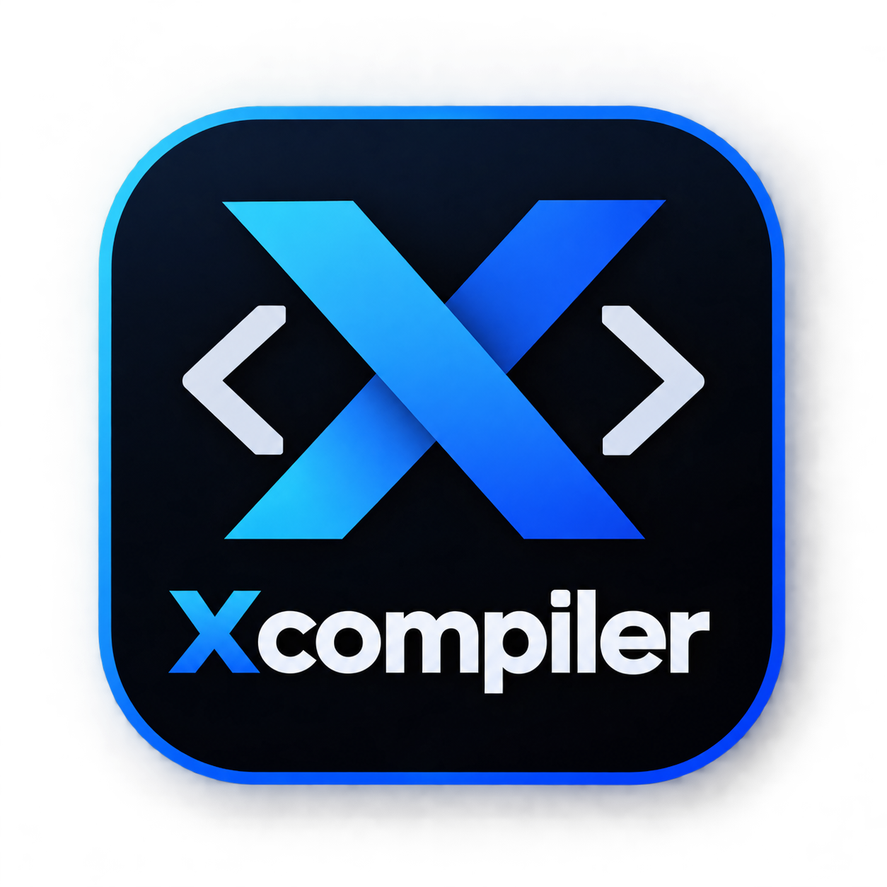

# XPort (Xcompiler)

Sistema para portar juegos de Xbox 360 a Android de forma nativa. Sale de un port anterior de GTA IV:
aquí hay una copia de sus fuentes, sin lo propio de GTA y RAGE en el
runtime y el renderizador. Cada juego es una ranura `games/<nombre>/` y un APK propio (`com.xport.<nombre>`).

**Cómo portar un juego: [GUIA.md](GUIA.md).** En corto:

    py -3 -I tools/port.py <juego.iso|default.xex|paquete XBLA|carpeta> <trabajo> <nombre> --label "Nombre"

y leer `<trabajo>/report.md`: del disco al APK en siete pasos (`--no-apk` para tras el arranque en el PC,
`--compare` lo compara con la GPU de Xenia). La interfaz `tools/gui` hace lo mismo con ventanas.

## Herramientas

| Paso | Herramienta | Comprobado |
| --- | --- | --- |
| Entrada | `xdvdfs.py` (ISO), `stfs.py` (CON/LIVE/PIRS) | ISO con GTA IV; STFS sin probar |
| Recompilar | `xport.py` (+ `scan_pe`, `find_chunks`, `fix_switch`, `fix_branches`, `find_fnptrs`) | GTA IV y EFLC |
| Funciones D3D y XDK | `find_d3d.py` (firma exacta y, si falla, por parecido), `signatures/xdk-2.0.6274.json` | GTA IV y EFLC: 58/58; con firmas alteradas un 30%, 47/58 y ninguna mal |
| Ranura e imports | `slot.py`, `gen_stubs.py` | GTA IV como ranura nueva |
| Shaders | `shaders.py`, `build-xenosrecomp.bat`, `shaders/` | con el volcado de GTA IV: igual que su caché |
| Shaders en tiempo real | `shader_translator.cpp` (renderizador), `build-dxc-android.bat` | GTA IV en el PC sin caché |
| Compilar | `build-host.bat`, `build-android.sh`, `build-apk.sh` (`XPORT_GAME`) | GTA IV, PC y APK |
| Arrancar y clasificar | `boot_test.py` (también FPS) | GTA IV en el PC |
| Nativo frente a Xenia | `compare_gpu.py` (`port.py --compare`) | GTA IV: 0 falsas alarmas; un tramo negro simulado, encontrado |
| Probar en el móvil | `phone_test.py` (`port.py --phone`) | GTA IV (ranura nueva) en un POCO X6 Pro: en marcha a los 4 min, 30 fps |
| Fluidez en el móvil | hilos de render y audio nombrados solos, `pipeline_recipes.bin` del arranque del PC | ver docs/GUIA.md |
| Todo + informe | `port.py`, `gui/` | GTA IV como ranura nueva, de principio a fin |

## Lo que no sale solo

1. **EDRAM:** el renderizador no la emula y confía en que los hooks de D3D le digan qué es cada recurso. Con otro
   motor puede faltar información; solo se puede probar con otro juego.
2. **Otro XDK:** las firmas y los offsets del device son de la 2.0.6274. Las funciones que no casan exactas se
   buscan por parecido (marcadas en el informe); los offsets de la estructura del device, si cambian, siguen a mano.
3. **Shaders:** los que faltan en la caché se traducen mientras el juego corre (XenosRecomp + DXC, como la
   caché). En el móvil hace falta `libdxcompiler.so` (`tools\build-dxc-android.bat`); sin ella, un shader que
   no está en la caché no se dibuja.

## Reglas

- Nada que salga de un juego se publica: discos, ejecutables, código recompilado ni shaders.
- El renderizador viene de LibertyRecomp (GPL-3): si se publica, hay que publicar su código con esa licencia.
- Requisitos: Android NDK 27.2, MSVC Build Tools 2022 y Python 3.
